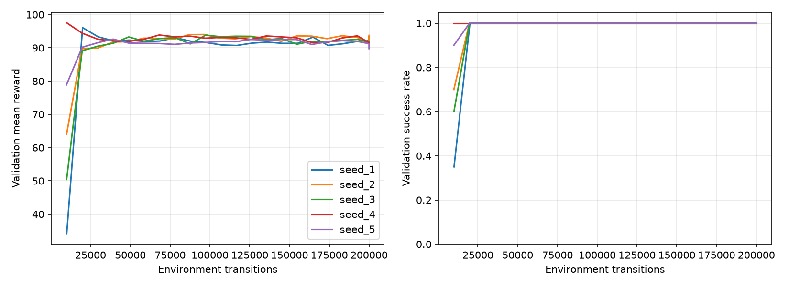
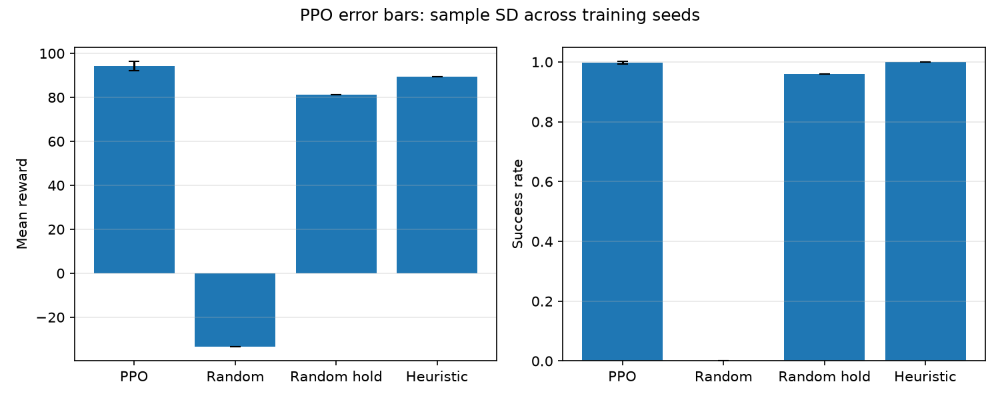

# PPO для MountainCarContinuous

Проект обучает PPO управлять машиной в `MountainCarContinuous-v0`. Агент принимает решение раз в 20 шагов среды и удерживает ограниченное действие между решениями. Это ограниченный класс политик: он не может менять управление на каждом шаге. Бюджет, длина эпизода и показатели считаются в исходных шагах среды, а не в решениях агента.

## Результаты проведённого эксперимента

Пять моделей PPO оценены на одинаковых 100 тестовых начальных состояниях каждая: 499 успехов из 500 (99,8%), цель 90% достигнута на этом наборе. После отбора по валидации выбрана модель seed 4; на тесте она достигла 99% успеха, остальные четыре — 100%. Выбор сделан до теста, а не по его результатам.

| Метод | Награда | Успех | Длина | Σ action² |
| --- | ---: | ---: | ---: | ---: |
| PPO, среднее ± SD между seed обучения | 94,230 ± 2,175 | 0,998 ± 0,004 | 298,036 ± 134,237 | 55,699 ± 24,774 |
| Выбранная модель PPO, seed 4 | 96,647 | 99% | 444,08 | 23,527 |
| random | −33,427 | 0% | 999,00 | 334,27 |
| random_hold | 81,363 | 96% | 434,51 | 146,38 |
| heuristic | 89,351 | 100% | 106,49 | 106,49 |

Средняя сумма квадратов управляющих действий PPO ниже, чем у эвристики, но эпизоды PPO в среднем длиннее. Это условная метрика затрат управления, а не физическая энергия. Разброс в строке PPO рассчитан между пятью обучениями; строка выбранной модели описывает один готовый артефакт. Пять моделей проверены на общих 100 начальных состояниях, а не на 500 разных стартах. Индивидуальные результаты PPO по seed обучения: 1 — 100%, 2 — 100%, 3 — 100%, 4 — 99%, 5 — 100%. Подробные показатели и данные: [отчёт](results/revised/report.md), [эпизоды](results/revised/test_episodes.csv), [JSON](results/revised/test_results.json); [видео выбранной модели](results/revised/selected.mp4).

Готовую модель можно проверить или записать повторно:

```powershell
python -m mountaincar evaluate --model results/revised/final/seed_4/best.pt --split test
python -m mountaincar record --model results/revised/final/seed_4/best.pt --output runs/demo/selected.mp4
```

## Расширенная проверка устойчивости

На новых 1 000 начальных состояниях каждая из пяти исходных моделей достигла 99,1–100% успеха; суммарно — 4 986/5 000 (99,72%). У выбранной по исходной валидации модели seed 4 — 995/1 000 (99,5%), средняя награда 97,037, средняя длина 446,05 шага. `random_hold` с повтором 20 дал 89,2%, эвристика — 100%. Показатель 96% для `random_hold` в исходном отчёте относится к меньшей выборке из 100 эпизодов.

Провал seed 20047 воспроизведён; сохранены графики и видео. На сетке из 201 позиции найдены единичные неудачные точки у моделей seed 1 и 4. [Подробный разбор, таблицы и команды](docs/robustness.md). Этот набор используется для диагностики; окончательный тест сравнения настроек отделён от него.

## Графики и видео





[Видео выбранной модели](results/revised/selected.mp4) · [Успешный эпизод](results/improvements/diagnostics/seed_4_20046.mp4) · [Провальный эпизод](results/improvements/diagnostics/seed_4_20047.mp4) · [Графики траекторий](results/improvements/diagnostics/seed_4_trace_comparison.png)

Видео показывают готовую политику. Анимация промежуточных этапов обучения пока не создана.

## Статус сравнения частот управления

Код сравнения повторов действия 1, 5, 10 и 20 реализован и проверен тестами; [протокол и команды](docs/experiments.md). Полный эксперимент ещё не завершён, конфигурация по его результатам не выбрана, окончательная оценка не выполнена. Незавершённые рабочие результаты этого сравнения исключены из Git. Показатели выше относятся к завершённому исходному эксперименту и его расширенной диагностике.

## Установка и быстрый запуск

Проверенная версия Python — 3.12. Склонируйте репозиторий и перейдите в его каталог:

```powershell
git clone https://github.com/VitaliyEgorov431/mountaincar-continuous-ppo.git
cd mountaincar-continuous-ppo
```

Затем установите зависимости и запустите проект:

```powershell
python -m venv .venv
.\.venv\Scripts\Activate.ps1
python -m pip install -r requirements.txt
python -m pip install --no-deps --no-build-isolation -e .
python -m mountaincar train --seed 0 --output-dir runs/demo
python -m mountaincar evaluate --model runs/demo/best.pt --output runs/demo/validation.json
python -m mountaincar record --model runs/demo/best.pt --output runs/demo/episode.mp4
python -m pytest
```

Обучение без `--config` использует стартовый бюджет 50 000 шагов среды; `config.json` задаёт 200 000 шагов для полного протокола. Оба варианта используют 8 сред, 32 решения на фрагмент, повтор действия 20 и проверку каждые 2 обновления. В проведённой стартовой проверке seed 0 доля успеха на валидации достигла 100% на шагах 19 904, 29 700, 39 428, 49 159 и 50 000; это результат одного запуска, а не итог эксперимента. Его файлы сохранены в `results/revised_probe/pilot/seed_0`. Старые контрольные точки без метаданных повтора загружаются с повтором 1. Оценка по умолчанию детерминированная; `evaluate --stochastic` использует выборки политики, не меняя генератор PyTorch обучения.

## Протокол эксперимента

Для полного эксперимента используйте зафиксированный `config.json` с бюджетом 200 000 исходных шагов и выполняйте фазы последовательно:

```powershell
python -m mountaincar experiment --config config.json --output-dir results/revised --phase pilot --resume
python -m mountaincar experiment --config config.json --output-dir results/revised --phase confirm --resume
python -m mountaincar experiment --config config.json --output-dir results/revised --phase final --resume
python -m mountaincar experiment --config config.json --output-dir results/revised --phase report
```

Пилот seed 0 должен достичь успеха не менее 90% на трёх последовательных проверках; затем тот же критерий должны пройти оба подтверждающих seed 11 и 12. Только после этого запускаются финальные seed 1–5 с тем же бюджетом и настройками. `--resume` использует только завершённые запуски с совпадающей конфигурацией; прерванное обучение начинается заново. Пилот на 200 000 шагов запускается заново с seed 0 и не продолжает веса стартовой проверки на 50 000 шагов. Тестовый набор используйте после фиксации модели; вручную он выбирается через `evaluate --split test`. Старые результаты сохраняются отдельно; новые записываются в `results/revised`. [Исторический диагноз прежнего подхода](docs/diagnosis.md) и исходные измерения сохранены; пересмотренный подход удерживает действия и описан выше.

## Как работает обучение

Политика выдаёт нормальное распределение действия. В среду передаётся выборка, ограниченная диапазоном [-1, 1]; PPO хранит исходную выборку и её логарифм плотности. При оценке по умолчанию используется ограниченное среднее. В рамках одного решения выполняется до `k=20` шагов среды, останавливаясь при завершении эпизода или исчерпании бюджета. Для обучения их награды объединяются с дисконтированием: `R = sum(gamma**j * r[j], j=0..k-1)`.

Для такого перехода `delta = R + gamma**k * (1-terminated) * V(next) - V(state)`, а рекурсия GAE использует `gamma**k * lambda` один раз на решение и обрывается на `terminated` или `truncated`. При лимите времени ценность последнего наблюдения учитывается до сброса. В отчётах награда — недисконтированная сумма исходных наград среды, энергия — сумма квадратов фактически выполненных действий.

Подробности: [разбор кода](docs/walkthrough.md), [протокол и интерпретация](docs/experiments.md). Источники: [PPO](https://arxiv.org/abs/1707.06347), [GAE](https://arxiv.org/abs/1506.02438), [лимиты времени Gymnasium](https://gymnasium.farama.org/tutorials/gymnasium_basics/handling_time_limits/).
