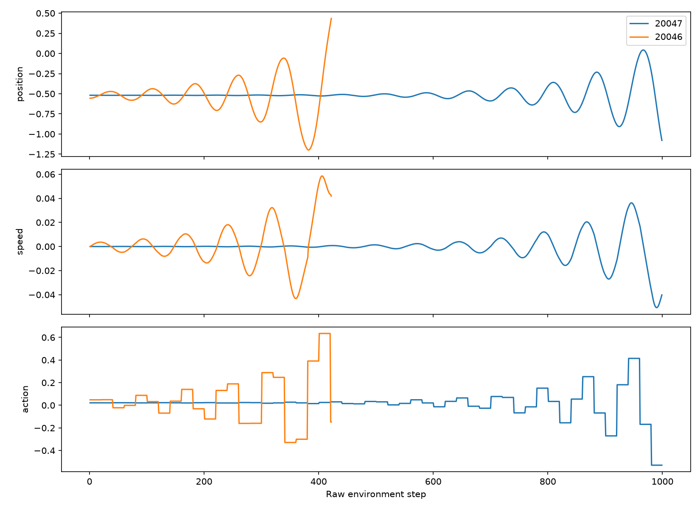

# Расширенная проверка исходных моделей

Проверка выполнена 9 ноября 2026 года. Веса пяти моделей из `results/revised/final` зафиксированы до проверки; обучение не выполнялось. Новый диагностический набор: 1 000 seed среды 30000–30999 для каждой модели и базовой стратегии. Дополнительно проверена сетка из 201 начальной позиции от −0,6 до −0,4 с нулевой скоростью. Все эпизоды ограничены 999 исходными шагами среды. Политики PPO детерминированные и удерживают действие 20 шагов; эвристика меняет управление на каждом шаге.

## Результаты на новых начальных состояниях

| Политика | Успех | Награда | Средняя длина | Медиана длины | 95-й перцентиль длины | Тайм-ауты |
| --- | ---: | ---: | ---: | ---: | ---: | ---: |
| PPO seed 1 | 99,1% | 95,585 | 458,92 | 425 | 797,05 | 9 |
| PPO seed 2 | 100% | 92,992 | 184,52 | 165 | 290 | 0 |
| PPO seed 3 | 100% | 92,719 | 191,08 | 170 | 292 | 0 |
| PPO seed 4, выбран по исходной валидации | 99,5% | 97,037 | 446,05 | 419 | 718 | 5 |
| PPO seed 5 | 100% | 92,131 | 229,68 | 201,5 | 393 | 0 |
| random_hold, повтор 20 | 89,2% | 72,897 | 494,37 | 420,5 | 999 | 108 |
| heuristic | 100% | 89,354 | 106,46 | 106 | 109 | 0 |

Пять моделей вместе достигли 4 986 успехов из 5 000 эпизодов (99,72%). Это пять моделей на 1 000 общих начальных состояниях, поэтому эпизоды нельзя считать 5 000 независимыми проверками одной политики. У выбранной модели seed 4 — 995 успехов из 1 000. Seed 2, 3 и 5 на этом наборе прошли все эпизоды и в среднем быстрее, но получили меньшую награду из-за более сильного управления. Смена выбранной модели на основании этой диагностики означала бы использование набора для разработки.

У `random_hold` успех снизился с 96/100 в исходном отчёте до 892/1000 на новом наборе. Прежняя оценка оказалась чувствительна к выборке. Сравнение подтверждает преимущество обученных моделей относительно этой случайной стратегии. Для случайной стратегии каждому seed среды соответствует одна фиксированная последовательность действий; отдельный разброс между повторениями случайных последовательностей не оценивался.

## Сетка стартовых позиций

На сетке исходная модель seed 1 завершила по лимиту один эпизод из 201 при позиции около −0,489, модель seed 4 — один при позиции около −0,519. Остальные три модели и эвристика прошли всю сетку. Шаг сетки равен 0,001; единичная неудачная точка не задаёт границы непрерывной области неудач. Для `random_hold` меняется также seed случайных действий, поэтому его неудачные точки нельзя интерпретировать как зависимость только от позиции.

## Разбор seed 20047

Провал выбранной модели воспроизведён: 999 шагов, стартовая позиция −0,51879555, максимальная достигнутая позиция около 0,043 при цели 0,45. Среднеквадратичная амплитуда действия — 0,121, максимальный модуль — 0,530; направление движения менялось 26 раз (переход из покоя не считается разворотом). В успешном сравнительном эпизоде seed 20046 модель достигла цели за 422 шага; среднеквадратичная амплитуда действия — 0,224, знак скорости менялся 10 раз.

График показывает длительные колебания при слабом управлении в неудачном эпизоде. Это согласуется с гипотезой недостаточного накопления размаха, но сравнение двух разных стартов не устанавливает причину. Проверка частоты управления выполняется отдельным экспериментом. Одиночная трассировка дала награду −1,461925 вместо −1,463179 в прежней пакетной оценке; исход одинаковый, побитовое совпадение не достигнуто. Небольшие численные различия при одиночном и пакетном вычислении политики могут накапливаться в траектории.



- [Видео неудачного эпизода](../results/improvements/diagnostics/seed_4_20047.mp4)
- [Видео успешного эпизода](../results/improvements/diagnostics/seed_4_20046.mp4)
- [Трассировка неудачного эпизода](../results/improvements/diagnostics/seed_4_trace_20047.csv)
- [Трассировка успешного эпизода](../results/improvements/diagnostics/seed_4_trace_20046.csv)

## Воспроизводимость и расход шагов

Запуск из каталога проекта:

```powershell
$env:OMP_NUM_THREADS = '1'
$env:MKL_NUM_THREADS = '1'
python -m mountaincar.diagnostics
```

Команда повторно записывает диагностические файлы в `results/improvements/diagnostics`; исходные результаты в `results/revised` не меняются. Полный набор эпизодов, метрик, SHA-256 контрольных точек, версии Python и библиотек доступны в [summary.json](../results/improvements/diagnostics/summary.json). CSV для каждой политики сохранены рядом (`*_new_seeds.csv`, `*_grid.csv`).

Расход: 2 528 180 исходных шагов оценки, 1 421 шаг трассировок и ещё 1 421 шаг повторных эпизодов для видео, всего 2 531 022 шага. Время первоначального выполнения — около 122 секунд; это измерение для конкретного компьютера.

В завершённом запуске сумма квадратов действий восстановлена из проверенного равенства `reward = 100 × success − 0,1 × sum(action²)`; это указано в метаданных. Текущая версия диагностического кода считает её напрямую. Изменения измерительной части после запуска раскрыты в метаданных; хеш текущего файла не следует считать хешем точной исполнявшейся версии.

После анализа этот набор считается диагностическим. Окончательное сравнение конфигураций использует отдельные seed 40000–40999 после фиксации конфигурации и контрольных точек.